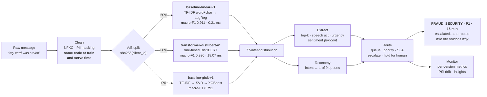

# ml-nlp-triage-engine

Classifies inbound customer messages into 77 banking intents, extracts sentiment
and intent shape, routes each record to a queue with a priority and an SLA, and
serves it all behind a FastAPI service that A/B tests two model versions with
per-version monitoring.



**The headline, stated honestly:** the fine-tuned transformer beats the TF-IDF
baseline by **+0.019 macro-F1** (0.9301 vs 0.9109) — real, and significant on a
paired test — but it costs **36× the training time**, **86× the per-record
inference cost when batched** (18.07 ms vs 0.21 ms), and it is *worse* on 16 of
the 77 intents. The baseline stays registered and servable for that reason. The
gradient-boosting baseline loses badly and carries zero traffic.

---

## Run it

```bash
docker compose up
```

Downloads the data, builds the splits, trains all three models, regenerates
every number quoted below, then serves on <http://localhost:8000>. First run
takes about 75 minutes on a CPU, almost all of it the transformer; artefacts
persist in a volume, so later runs start the API immediately.

Without Docker:

```bash
bash scripts/setup.sh && make demo
```

Shorten the fine-tune with `TRIAGE_EPOCHS=2` — the trainer will warn you that
the results no longer match this README.

```bash
curl -s -X POST localhost:8000/v1/triage -H 'Content-Type: application/json' -d '{"text":"My card was stolen this morning and I need it blocked urgently!","client_id":"cust-0001"}'
```

```jsonc
{
  "model_version": "transformer-distilbert-v1",
  "ab": { "reason": "hash bucket 0.5022", "unit_id": "cust-0001" },
  "classification": {
    "intent": "lost_or_stolen_card", "confidence": 0.9891, "margin": 0.9864,
    "category": "identity_security", "speech_act": "problem_report",
    "urgency": 0.6, "urgency_markers": ["urgently", "exclamation"],
    "top_k": [ { "intent": "lost_or_stolen_phone", "score": 0.0028 }, "..." ]
  },
  "sentiment": {
    "compound": -0.7424, "label": "negative", "is_calibrated": false,
    "matched_domain_terms": ["blocked"]
  },
  "routing": {
    "queue": "FRAUD_SECURITY", "priority": "P1", "sla_minutes": 15,
    "escalate": true, "auto_routed": true, "needs_human_review": false,
    "reasons": [
      "category 'identity_security' has base priority P1",
      "category 'identity_security' is security-critical -> P1, escalated",
      "strongly negative sentiment (-0.74) (no further escalation available)",
      "urgency 0.60 with markers ['urgently', 'exclamation'] (no further escalation available)"
    ]
  }
}
```

Every routing decision carries the reasons that produced it, including the ones
that tried to fire and could not — an operator should not have to guess why a
record landed where it did.

---

## Data

**BANKING77** (PolyAI), **CC-BY-4.0**, 13,083 English customer-service messages
over 77 intents. Downloaded at build time, never redistributed here. Full
provenance, attribution and caveats: [`data/DATASET_CARD.md`](data/DATASET_CARD.md).

The ETL is not a formality — it found things:

| | |
| --- | ---: |
| Published rows (train / test) | 10,003 / 3,080 |
| Exact duplicates dropped | 6 / 1 |
| Texts with conflicting labels | **0** |
| Train rows colliding with test after cleaning, removed from train | **7** |
| Final split (train / val / test) | **8,491 / 1,499 / 3,079** |

Test is the published split, untouched. Validation is a 15% stratified slice of
published train. Cleaning normalises Unicode and masks card numbers, sort codes,
IBANs, emails, amounts and dates — and because masking collapses records that
differed only by a number, it *created* 7 train/test collisions that did not
exist in the raw data. Those rows are dropped from train, never from test.

### Class imbalance, and an honest note about it

| Split | Level | Min | Max | Ratio | Normalised entropy |
| --- | --- | ---: | ---: | ---: | ---: |
| train | intent (77) | 30 | 159 | 5.3:1 | 0.9919 |
| train | category (9) | 535 | 1,364 | 2.55:1 | 0.9787 |
| test | intent (77) | 39 | 40 | 1.03:1 | 1.0000 |

Both baselines use `class_weight="balanced"`; the transformer uses the identical
weights in its `CrossEntropyLoss`, so the comparison is not confounded by the
models being given different treatment of the distribution.

**But the imbalance here is mild.** A 5.3:1 ratio at normalised entropy 0.99 is
close to balanced, and the published test set is balanced exactly. Weighting is
the right default and it is applied consistently, but this dataset is not
evidence that it *helped* — it is not a severe-imbalance benchmark, and claiming
a win from it would be overselling. Where imbalance genuinely bites is the
**category** level, which is why macro-F1 rather than accuracy is the headline
there: the 9 queues hold between 5 and 11 intents each and between 199 and 440
test records.

---

## Results

Held-out test split, 3,079 records, 77 intents. No model saw it during training
or model selection.

| Model | Intent macro-F1 | Intent acc. | Acc. 95% CI | Category macro-F1 | Top-3 acc. | ECE | Train | ms/record (single) | ms/record (batched) |
| --- | ---: | ---: | :---: | ---: | ---: | ---: | ---: | ---: | ---: |
| **transformer-distilbert-v1** | **0.9301** | 0.9302 | 0.921–0.939 | **0.9725** | 0.9821 | 0.0297 | 65 min | 19.05 | 18.07 |
| **baseline-linear-v1** | 0.9109 | 0.9107 | 0.901–0.920 | 0.9590 | 0.9756 | 0.0291 | 110 s | **7.08** | **0.21** |
| baseline-gbdt-v1 | 0.7910 | 0.7918 | 0.778–0.806 | 0.8842 | 0.9237 | 0.0324 | 156 s | 9.22 | 0.46 |

Full report: [`experiments/results/model_comparison.md`](experiments/results/model_comparison.md).

The two latency columns tell different stories and both are worth having. Under
batching the transformer costs **86×** what the linear model does per record.
On a single isolated request the gap collapses to **2.7×**, because scikit-learn
spends around 7 ms building TF-IDF features for one document regardless of how
trivial the model behind them is — overhead the transformer simply does not
have. If the service handles one message at a time, the latency argument against
the transformer is much weaker than the batched figure suggests.

**On the fine-tuning schedule.** An earlier 4-epoch run at lr 3e-5 reached only
0.8855 test macro-F1 and *lost* to the linear baseline. That result is not
reported above because it was an under-trained model, not a fair comparison —
its validation score was still climbing when the schedule ended. The reported
run is 8 epochs at lr 5e-5, where validation plateaus from epoch 4 (0.9078,
0.9073, 0.9072, 0.9073, 0.9109). Note that the best epoch is the last one, so a
longer schedule might squeeze out a little more; the flat plateau in between
suggests not much. Declaring the baseline the winner off the short run would
have been the easier story and the wrong one.

### Did the transformer actually win?

Yes, and it is worth being precise about how we know.

**Paired test (the right one).** Both models scored on the same 3,079 records.
196 records where exactly one was right — 128 only the transformer, 68 only the
baseline. McNemar χ² = 17.76, **p = 2.5 × 10⁻⁵**. Significant.

**Unpaired A/B test (weaker, and it disagrees).** In the live-path replay the
two arms see *disjoint* records. Difference +0.0190, 95% CI **−0.0002 to
+0.0382**, p = 0.054 — **not** significant at 0.05.

Same models, same data, opposite verdicts, and neither is wrong. The paired test
controls for record difficulty and so has far more power; the A/B test throws
that away by splitting the sample. This is exactly why the offline comparison
decides which model is better and the A/B test only decides whether the
deployment behaves. Reporting only the A/B result would understate the model;
reporting only the paired result would overstate what an experiment on live
traffic could detect at this sample size.

### Where the baseline wins

The transformer is better on **50** intents, the baseline on **16**, tied on 11.
None of the 16 regressions exceeds 0.05 F1, but they are real and they are all
listed in the report rather than averaged away. The five largest:

| Intent | Category | Baseline F1 | Transformer F1 | Delta |
| --- | --- | ---: | ---: | ---: |
| `card_acceptance` | `cards_usage` | 0.9231 | 0.8750 | −0.0481 |
| `declined_card_payment` | `payments_disputes` | 0.9195 | 0.8764 | −0.0431 |
| `getting_spare_card` | `cards_lifecycle` | 0.9367 | 0.8974 | −0.0393 |
| `cancel_transfer` | `transfers` | 0.9620 | 0.9231 | −0.0389 |
| `topping_up_by_card` | `top_up` | 0.8718 | 0.8354 | −0.0364 |

Two of them — `declined_card_payment` and `compromised_card` — feed the disputes
and fraud queues, which is where errors cost the most. That is an argument for
looking at the per-class table before promoting a model, not just the aggregate.

### Why gradient boosting lost

Not a tuning failure. Trees cannot use 34,000 sparse TF-IDF columns, so the
features must be projected down first, and `TruncatedSVD(256)` **retains only
42% of the TF-IDF variance**. The linear model reads all 34,000 columns
directly. On short, high-dimensional, nearly-linearly-separable text, that is
the whole story — and it is a good reminder that "gradient boosting is strong on
tabular data" does not transfer to bag-of-words text.

### Confidence thresholds are per version

Below its threshold, a record is held for a human instead of auto-routed. The
threshold is chosen on validation against an explicit cost model — one wrong
auto-route costs the same as 5 manual reviews.

| Version | Threshold | Auto-route rate | Selective accuracy |
| --- | ---: | ---: | ---: |
| `baseline-linear-v1` | 0.75 | 81.2% | 0.9712 |
| `transformer-distilbert-v1` | 0.95 | 86.0% | 0.9674 |
| `baseline-gbdt-v1` | 0.90 | 55.4% | 0.9542 |

These are deliberately **not** shared. Mean top-1 probability on validation runs
from 0.79 (gradient boosting) to 0.96 (transformer), so one number would either
hold back most of the linear model's correct predictions or wave through most of
the transformer's wrong ones. `config/routing_policy.json` holds the per-version
values and is regenerated by the experiment itself
(`--write-config`). [`confidence_threshold.md`](experiments/results/confidence_threshold.md).

### A/B deployment behaviour

| Version | Records | Share | Intent acc. | Auto-route | Human review | Escalated | p50 | p95 |
| --- | ---: | ---: | ---: | ---: | ---: | ---: | ---: | ---: |
| `baseline-linear-v1` | 1,563 | 0.5076 | 0.9098 | 0.862 | 0.161 | 0.148 | 0.5 ms | 0.7 ms |
| `transformer-distilbert-v1` | 1,516 | 0.4924 | 0.9288 | 0.889 | 0.130 | 0.141 | 26.9 ms | 45.6 ms |

Split balance: χ² = 0.717, p = 0.40 — the hash splitter is not skewed. Drift PSI
across text length, category mix and confidence: **0.007 to 0.036, all "stable"**
— a negative control showing the detector does not fire on data drawn from the
training distribution. [`ab_experiment.md`](experiments/results/ab_experiment.md),
[design](docs/AB_TESTING.md).

### Sentiment: reported, never scored

**BANKING77 has no sentiment labels, so there is no sentiment accuracy in this
repository and there cannot be one.** The scorer is VADER plus a 24-term banking
lexicon. Every API response carries `is_calibrated: false`.

What can be checked is face validity, and it holds: correlation between a
category's priority and its mean sentiment is **+0.5232** (urgent categories
score more negatively), `identity_security` is the most negative category
(−0.064) and `account_admin` the most positive (+0.085); by speech act,
`problem_report` averages −0.176 against `request` at +0.174. That shows the
scorer is not broken. It does not show it is right — and it nonetheless nudges
routing priority, which is a real risk documented in
[LIMITATIONS](docs/LIMITATIONS.md#sentiment-is-not-evaluated).

---

## How routing works

Predicted intent → category via [`data/TAXONOMY.md`](data/TAXONOMY.md) (9 queues,
each with a queue name, SLA and base priority) → rules in
[`src/routing/rules.py`](src/routing/rules.py) that may escalate, cap at two
steps, and hold low-confidence records.

Two invariants are pinned by tests:

1. **Priority is never lowered below the category base.** Rules escalate only. A
   wrong sentiment reading can make something more urgent than it needed to be,
   which is recoverable; the reverse is not.
2. **Security-critical records are never parked.** A low-confidence suspected
   fraud report still goes to `FRAUD_SECURITY`, flagged for a human — it does not
   sit in a manual-triage backlog.

Routing is rules rather than a model because the dataset has no routing labels,
so a learned router could not be evaluated. There is **no routing accuracy
figure** here, and inventing one would be dishonest.

---

## API

| Endpoint | Purpose |
| --- | --- |
| `POST /v1/triage`, `/v1/triage/batch` | Classify, extract, route. `?version=` forces a model |
| `GET /v1/models`, `/v1/ab` | Registered versions, weights, realised split |
| `PUT /v1/ab/weights` | Shift traffic live; deliberately not persisted to disk |
| `GET /v1/insights` | Volume, sentiment, queues, review load — overall and per version |
| `GET /v1/monitoring/drift` | PSI against training and per-version references |
| `GET /metrics` | Prometheus; **every series labelled by `version`** |
| `GET /healthz`, `/readyz` | Live vs ready — starts and reports 503 when untrained, rather than crash-looping |

Batching is by model version, so a mixed batch under a 50/50 split becomes two
model calls, not one per record. Details: [MONITORING](docs/MONITORING.md),
[ARCHITECTURE](docs/ARCHITECTURE.md).

---

## Reproducing every number above

Everything was produced on CPython 3.9.0, Windows 11, **CPU only** (AMD Ryzen 7
5700X, 16 threads, torch 2.2.2+cpu). No GPU path was exercised.

| Numbers | Command | Output |
| --- | --- | --- |
| Split sizes, duplicates, leakage, imbalance | `python -m src.etl.build_dataset` | `artifacts/data/processed/dataset_manifest.json`, `class_stats.json` |
| Model table, McNemar, per-class deltas | `python -m experiments.compare_baseline_transformer` | [`model_comparison.md`](experiments/results/model_comparison.md), [`per_class_comparison.csv`](experiments/results/per_class_comparison.csv) |
| Thresholds, auto-route rates, selective accuracy | `python -m experiments.tune_confidence_threshold` | [`confidence_threshold.md`](experiments/results/confidence_threshold.md) |
| Traffic split, per-arm behaviour, drift, latency | `python -m experiments.run_ab_experiment` | [`ab_experiment.md`](experiments/results/ab_experiment.md) |
| Sentiment descriptive statistics | `python -m experiments.sentiment_face_validity` | [`sentiment_face_validity.md`](experiments/results/sentiment_face_validity.md) |
| All of the above | `bash scripts/train_all.sh` | `experiments/results/` |

`experiments/results/` is committed, so the numbers are checkable without
rerunning an hour of training. Nothing under `artifacts/` is committed, and no
binary is stored in Git history or Releases. A containerised run writes its own
copies to `artifacts/docker-results/` (gitignored) rather than over the
committed ones; `make docker-results` diffs the two.

**How exactly these reproduce.** Re-running in the Linux container reproduced
`baseline-linear-v1` to four decimal places on every metric (0.9109 macro-F1,
0.0291 ECE — scikit-learn's logistic regression is deterministic here).
`baseline-gbdt-v1` did **not**: 0.7910 on Windows against 0.7951 in the
container, because XGBoost's `hist` tree method with `n_jobs=-1` varies with
platform and thread count. So "reproducible" means the scripts regenerate every
figure from scratch, not that the last decimal is stable across machines. The
transformer carries the usual additional float non-determinism on top of that.

```bash
make test    # 189 tests, no trained models required
make lint
```

CI runs the suite on Python 3.9, 3.11 and 3.12, checks `data/TAXONOMY.md` is
regenerated from its JSON source, trains the linear baseline end-to-end and
drives the live API, and builds the Docker image.

---

## Layout

```
src/etl/          download · clean · dedupe · leakage control · split · stats
src/models/       IntentClassifier interface · registry · baselines · transformer
src/extraction/   sentiment (lexicon) · speech act and urgency (rules)
src/routing/      triage rules · hash-based A/B assignment
src/api/          TriageService (HTTP-independent) · FastAPI app
src/monitoring/   prediction window · Prometheus metrics · PSI drift · insights
experiments/      every number in this README
data/             taxonomy (JSON source of truth) · dataset card
tests/            189 tests — stubs for units, real artefacts for integration
```

---

## Limitations

Read [`docs/LIMITATIONS.md`](docs/LIMITATIONS.md) before reusing any of this. The
short version:

- **Sentiment, speech act and urgency are unevaluated** — no labels exist for
  them. Sentiment still influences routing priority.
- **The 9 categories are ours**, hand-mapped over the 77 intents, with no
  external validation. Every category metric inherits that.
- **Routing quality is unmeasured.** The rules are tested; whether the policy is
  *good* is a business question this repo cannot answer.
- **Monitoring is in-memory and single-process.** Every response says so
  (`store.durable: false`). Multi-replica deployments each hold their own window.
- **Drift detection catches input drift only** — not concept drift, which needs
  a feedback loop that does not exist here.
- **The data is not a support inbox**: single-label, median 13 tokens, no
  timestamps, crowdsourced and clean.
- **No auth, rate limiting, calibration, automated retraining or alerting.**

---

## Licence

Code: [MIT](LICENSE). BANKING77 is CC-BY-4.0 and is not redistributed here — see
[`data/DATASET_CARD.md`](data/DATASET_CARD.md) for attribution.
