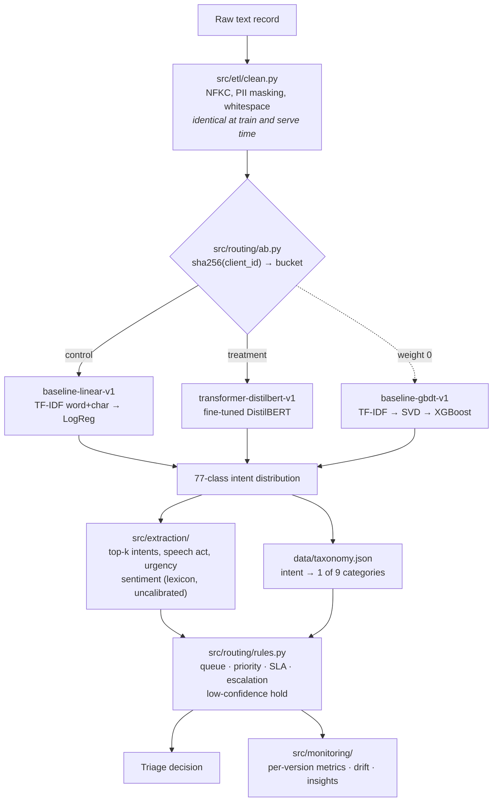

# Architecture

## Flow of one record



## Why the pieces sit where they do

**Cleaning is shared between training and serving.** `src/etl/clean.py` is a
pure function called by both the ETL and `TriageService`. The commonest way to
get a model that works offline and fails in production is to normalise text one
way in the notebook and another way in the service; having one module and no
second implementation removes that failure mode by construction.

**The service never imports a model class.** It asks
`src/models/registry.py` for something satisfying `IntentClassifier` and calls
`predict`. That interface is the reason a TF-IDF pipeline and a fine-tuned
transformer can sit behind the same A/B split without the routing or monitoring
code knowing which is which.

**Category is derived, not predicted.** The models predict one of 77 intents.
The 9 triage categories come from mapping that prediction through
`data/taxonomy.json`. There is no second classifier. This means category
metrics inherit intent errors that cross a queue boundary and forgive those
that do not, which is exactly the behaviour routing cares about — see
`tests/test_models.py::test_category_metrics_forgive_within_category_confusion`.

**Routing is rules, not a model.** The dataset has no routing, urgency or
sentiment labels, so a learned router could not be evaluated. Explicit rules in
`src/routing/rules.py` can at least be read, argued with and unit-tested. The
two invariants they guarantee — priority is never lowered below the category
base, and security-critical records are never parked in a manual queue — are
pinned by tests.

**A/B assignment is a pure hash.** No assignment table, no shared state between
replicas, and the offline experiment recomputes exactly what the service would
have done. See [AB_TESTING.md](AB_TESTING.md).

## Repository layout

```
src/
  config.py            paths, seeds, thresholds
  taxonomy.py          loader for data/taxonomy.json
  etl/                 download, clean, dedupe, leakage control, split, stats
  models/
    base.py            IntentClassifier interface, top-k, metadata I/O
    evaluate.py        metrics at intent and category level
    registry.py        version discovery and lazy loading
    baseline/          TF-IDF linear and gradient boosting
    transformer/       fine-tuning loop and batched inference
  extraction/          sentiment (lexicon), speech act and urgency (rules)
  routing/
    rules.py           queue, priority, SLA, escalation, low-confidence hold
    ab.py              hash-based version assignment
  api/
    service.py         the pipeline, independent of HTTP
    app.py             FastAPI endpoints
    schemas.py         request and response models
  monitoring/
    store.py           bounded in-memory window of served predictions
    metrics.py         Prometheus series, all labelled by version
    drift.py           PSI against training and per-version references
    insights.py        aggregated reporting
experiments/           every number quoted in the README
data/                  taxonomy, dataset card
docker/                Dockerfile
scripts/               setup, train_all, demo
tests/                 unit tests on stubs, integration tests on artefacts
```

## Artefacts

Nothing under `artifacts/` is committed. It is rebuilt by
`bash scripts/train_all.sh`:

```
artifacts/
  data/raw/            downloaded BANKING77 CSVs
  data/processed/      train/val/test splits, manifest, class stats, drift reference
  models/<version>/    model file, metadata.json, metrics.json, drift_reference.json
  logs/
```

`experiments/results/` *is* committed — it is text-only, and it is what makes
the README's numbers checkable without rerunning an hour of training.
